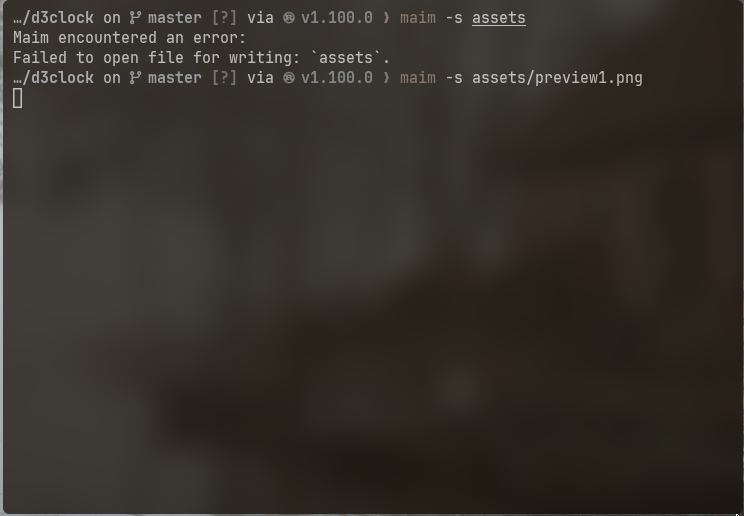

# d3clock

Minimalist terminal clock written in Rust. Automatically adapts to terminal color schemes (`pywal`, `base16`).



## Quick Install

```sh
git clone https://github.com/d3sydev/d3clock.git /tmp/d3clock && cd /tmp/d3clock && ./install.sh && rm -rf /tmp/d3clock
```

## Usage

```sh
d3clock
```
